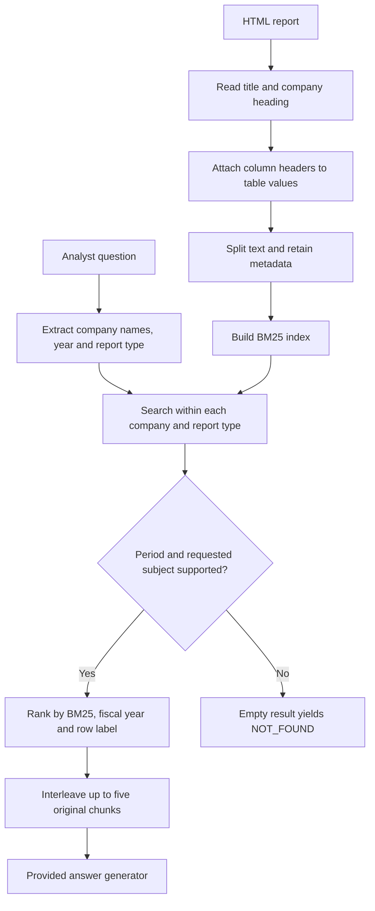

# Financial report retrieval

## Homework 4 solution

A question about cash at year end needs both a company and a date. Even a relevant balance sheet can give the wrong answer if its second column belongs to a different year.



The parser reads the company from the main heading and the fiscal year and report type from the title. It keeps the table caption and puts the column header beside each value. The recursive splitter uses 1,200 characters and 120 characters of overlap. Every chunk keeps its source, company, fiscal year and document type. BM25 uses lowercase whitespace tokens. At query time the router combines the names found at ingestion with patterns for unfamiliar names. It searches each named company separately so that a comparison has room for both sides. The final configuration checks period coverage and looks for words that identify the requested disclosure. Within the surviving groups, an exact fiscal-year match and a matching table row label receive extra weight. The generator sees the best remaining chunks in round-robin order. An empty result skips the generator.

### Public ablation study

Each row changes one component of the previous configuration. Each configuration ran once on the same 60 public questions with the instructor's generator. Recall and kept use the 46 answerable questions as their denominator. Rejected uses the 14 unanswerable questions. Accuracy uses all 60.

| Version | Change | Recall@5 | Kept | Rejected | Correct | Generator calls | Input / output tokens | Seconds | Points / 75 |
|---|---|---:|---:|---:|---:|---:|---:|---:|---:|
| B0 | Plain HTML text, recursive splitting, global BM25 top five | 26.1% | 100% | 0% | 26/60 | 60 | 100412 / 181 | 6.8 | 28.67 |
| V1 | Preserve row and column labels during table extraction | 28.3% | 100% | 0% | 26/60 | 60 | 98333 / 181 | 7.1 | 28.67 |
| V2 | Route the search by parsed company and report type | 43.5% | 100% | 0% | 36/60 | 60 | 93062 / 183 | 6.7 | 42.00 |
| V3 | Rerank candidates using the report year and printed row label | 97.8% | 100% | 0% | 59/60 | 60 | 110514 / 191 | 7.3 | 64.67 |
| V4 | Apply the evidence check and return an empty list on failure | 97.8% | 100% | 100% | 59/60 | 46 | 83740 / 151 | 5.6 | 74.67 |

Keeping column labels improved recall by one question but left the number of correct answers unchanged. Many relevant rows still sat outside the five passages sent to the model. Routing by company and report type brought ten more answers into the correct column of the score sheet. Reranking made the largest difference. It gave priority to a report for the requested year and to passages where the words in the question matched the label beside the figures. Because both features belong to the same reranker, this comparison cannot tell us which feature accounted for more of the gain.

The evidence check changed the cost of answering questions the library could not support. V3 already gave the correct final response on those questions, but still sent passages to the generator. V4 rejected all 14 beforehand, saving 14 calls in this run. Its lexical checks depend on how the question is phrased. A valid disclosure described using an unfamiliar synonym could be rejected on a new corpus.

### Error analysis

On q031 the question asks which of two companies had the higher FY2024 net income. V4 parsed both companies and the year correctly and returned passages from two files. The scorer still found incomplete evidence among the five chunks, and the generator returned NOT_FOUND. Finding both companies' reports was only the first step. Each passage also needed to contain the actual value for the requested year. A follow-up experiment could give each company one slot reserved for its best matching table row and see whether this recovers q031 without losing nearby context on other questions.

The final public run passed all twelve table tests and all forty document checks. Its 45/46 evidence hits earned full recall points under the rubric. Private-set performance is unknown. The [trial outputs](experiments/) contain per-question CSVs and the official score logs for all five versions. [Final results](results.csv) is the V4 output.

### Running the project

Use Python 3.10 or newer and install the packages in requirements.txt. Put DEEPSEEK_API_KEY in your environment or a local .env. From the repository root run:

```sh
python -m pip install -r requirements.txt
python hw4.py --data-folder public_test
python ablation.py
```

The first evaluation writes results.csv. The last command runs B0 through V4 and writes their evidence to experiments/. Each invocation rebuilds its index from the supplied corpus. Running the generator requires a funded DeepSeek key.

## Reflection

Ten years from now, I would want people to feel comfortable telling me that something I had made was wrong. That sounds like a small ambition until I imagine an office full of agents producing polished answers in seconds. In that office, the person who can interrupt a meeting and say “I checked the number, and we should change our decision” would still matter. I would like to be someone who welcomes that interruption, including when the number was mine.

This assignment gave me a small example. A system could name both companies in a question, find both reports and still lack the evidence for a comparison. Looking at the two passages takes longer than reading the final answer. I would keep doing that part myself when a decision affects someone else. The time spent finding my mistake teaches me what to look for the next time. It also gives me something honest to say to a colleague who asks how sure I am.

I still want to understand businesses well enough to help people make decisions about them. I also want my friends to know they can call me when there is nothing practical I can fix. Listening through an awkward silence is a skill I would willingly spend years learning, even if an agent could suggest a graceful reply. I think my identity would live in those choices about attention and responsibility. Tomorrow I can start with one small habit: before I pass along an AI-generated answer, open the source, read the relevant line, and write down what would make me change my mind.
